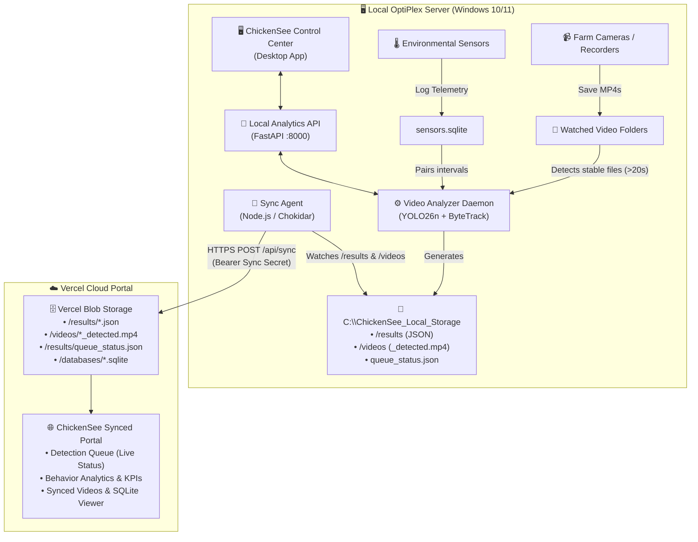

# 🐔 ChickenSee — OptiPlex Server Integration & Setup Guide

A complete, step-by-step guide to installing, configuring, and running the **ChickenSee Vision & Telemetry System** on your local Dell OptiPlex server and integrating it seamlessly with your Vercel cloud portal.

---

## 🏗️ Architecture Overview



---

## 📋 Prerequisites on the OptiPlex

Before starting, ensure your Dell OptiPlex has the following installed:

1. **Operating System**: Windows 10 or 11 (64-bit).
2. **Python**: Python 3.10, 3.11, or 3.12:
   - ⚠️ **Important during Python installation**: Check the box **"Add Python to PATH"**.
   - Verify `python.exe` and `pythonw.exe` are available in PowerShell:
     ```powershell
     python --version
     ```
3. **Node.js**: Node.js 18, 20, or newer (LTS recommended):
   - [Download Node.js](https://nodejs.org/)
   - Verify in PowerShell:
     ```powershell
     node --version
     npm --version
     ```
4. **Git**: [Download Git for Windows](https://git-scm.com/) (optional, but recommended).
5. **Model Weights**: Ensure `custom_poultry.pt` is in the repository root folder.

---

## 🚀 Step 1: Clone or Copy the Repository

Place the project on your OptiPlex (e.g., in `C:\Users\<YourUser>\Documents\ChickenSee_Videos(sql)` or `C:\ChickenSee`):

```powershell
cd C:\Users\<YourUser>\Documents\ChickenSee_Videos(sql)
```

Confirm that `custom_poultry.pt` and `favicon.ico` are in the folder:
```powershell
Test-Path custom_poultry.pt
Test-Path favicon.ico
```

---

## 📦 Step 2: Install Local Dependencies

Open **PowerShell** in the repository root directory and run:

```powershell
# 1. Install Python analytics & AI packages
python -m pip install --upgrade pip
python -m pip install -r analytics\requirements.txt

# 2. Install Sync Agent Node.js dependencies
Push-Location agent
npm ci
Pop-Location
```

> **Tip:** You can also click the **"Initialize / repair"** button in the Desktop App to do this automatically.

---

## 🖥️ Step 3: Launch ChickenSee Desktop Control Center

Launch the graphical Control Center app:

```powershell
python startup\chickensee_desktop.py
```

You will see the branded **ChickenSee Control Center** with the official rooster icon and live system tabs:
- **Dashboard**: Start/Stop services, process status, quick video test.
- **Queue**: Real-time detection queue, progress bar, frame counts, and cancel button.
- **Setup**: Folder configuration, local storage path, and Vercel cloud sync.

---

## ⚙️ Step 4: Configure Setup (Watch Folders & Storage)

In the Control Center, click on the **Setup** tab:

1. **Video Folders to Watch**:
   - Click **"Add folder…"** and select the folder(s) where your cameras or DVR save MP4 recordings.
   - *Example:* `D:\CameraRecordings` or `C:\FarmVideos`.
2. **Local Results and Logs**:
   - Default: `C:\ChickenSee_Local_Storage`
   - Keeps your raw footage safe and stores generated `results/` (JSON), `videos/` (`_detected.mp4`), and `logs/`.
3. **Optional Vercel Cloud Sync**:
   - Check the box: **"Upload videos and analysis results to my Vercel portal"**.
   - **Sync URL**: Enter your deployed Vercel domain followed by `/api/sync`:
     ```text
     https://your-chickensee-portal.vercel.app/api/sync
     ```
   - **Sync Secret**: Enter the same secret configured on your Vercel project environment variables (e.g. `SYNC_SECRET`).
4. Click **"Save settings"**.

---

## ☁️ Step 5: Configure Vercel Portal Environment Variables

In your [Vercel Dashboard](https://vercel.com/dashboard) under **Settings → Environment Variables**, ensure these 4 variables are set:

| Variable | Description | Example |
|---|---|---|
| `BLOB_READ_WRITE_TOKEN` | Generated automatically by attaching a Vercel Blob store | `vercel_blob_rw_...` |
| `SYNC_SECRET` | Secret key matching the OptiPlex desktop app | `your-secret-password-123` |
| `DASHBOARD_PASSWORD` | Password you use to log in to the web portal | `farm-admin-2026` |
| `JWT_SECRET` | 32-character random string for session tokens | `a-secure-random-32-char-string` |

---

## 🧪 Step 6: Test Video Analysis & Live Queueing

1. Go to the **Dashboard** tab in ChickenSee Control Center and click **"▶ Start ChickenSee"**.
2. Verify all three services turn **green**:
   - 🟢 **Folder watcher**: Running
   - 🟢 **Analytics API**: Running (port 8000)
   - 🟢 **Video analyzer**: Running
3. Test a sample video:
   - Under **Quick video test**, select your watch folder and click **"Choose a video and test"**.
   - Select any short MP4 video. A copy is placed in your watch folder.
4. Switch to the **Queue** tab in the desktop app:
   - When the file finishes writing and stays stable for ~20s, it enters **PROCESSING**.
   - You will see the active video name, live progress bar, and frame counts.
5. Open your **Vercel Web Portal** (`https://your-chickensee-portal.vercel.app`):
   - In the top header next to "Optiplex Live", observe the live badge:
     `● Queueing: chickensee-test... (45%)`
   - Click the **"Detection Queue"** tab to view the live progress, active video name, and queued items without streaming raw videos!

---

## 🔄 Step 7: Enable 24/7 Autostart on Boot

To make sure ChickenSee automatically runs whenever the OptiPlex boots up:

1. In ChickenSee Control Center, go to the **Setup** tab.
2. Click **"Enable startup"**.
3. This registers:
   - A **ChickenSee Control Center** shortcut on your Windows Desktop (with the official icon).
   - The `startup\start-chickensee.bat` launcher in Windows Startup (`ChickenSee.lnk`) and the current user's Run key. It starts the background supervisor, which launches the watcher, API, and analyzer when your Windows user signs in.

> **To verify autostart:** Restart the OptiPlex and sign in. Within 15 seconds, the services will start automatically in the background.

---

## 📁 Key File Locations on OptiPlex

| Item | Location on OptiPlex |
|---|---|
| **Desktop App Shortcut** | `Desktop\ChickenSee Control Center.lnk` |
| **Startup Shortcut** | `shell:startup\ChickenSee.lnk` |
| **Local Results (JSON)** | `C:\ChickenSee_Local_Storage\results\` |
| **Annotated Videos** | `C:\ChickenSee_Local_Storage\videos\` |
| **Queue Status Payload** | `C:\ChickenSee_Local_Storage\results\queue_status.json` |
| **Service Logs** | `C:\ChickenSee_Local_Storage\logs\` |
| **Watch Folder Config** | `<RepoRoot>\agent\directories.json` |
| **Sync Credentials** | `<RepoRoot>\agent\.env` *(automatically ignored by Git)* |

---

## 🛠️ Maintenance & Troubleshooting

- **Queue says "Offline / Services Stopped"**:
  Open the Control Center desktop shortcut and click **"▶ Start ChickenSee"** on the Dashboard.
- **Videos are not being analyzed**:
  Ensure the video is in an MP4 container and has been stable (unchanged file size) for at least 20 seconds.
- **Cloud Uploads not showing on Vercel**:
  Confirm that **Cloud Sync** is toggled ON in the Setup tab and that your `SYNC_SECRET` matches your Vercel environment variable exactly.
- **View Live Logs**:
  Click **"Open logs"** on the Dashboard to inspect `worker.log`, `watcher.log`, or `api.log`.
- **API Documentation**:
  Visit `http://127.0.0.1:8000/docs` in your browser on the OptiPlex to interactively query the local FastAPI service.
